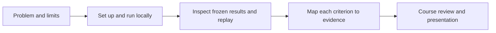

**EN** | [RU](docs/README.ru.md)

# Precious Metals ETF Forecasting with CFTC Positioning

This project investigates whether CFTC futures positioning and market history can help predict the next five-session return of GLD and SLV, and compares hypothetical signals with passive ETF ownership. It is an educational research workflow, not investment advice.

## Current evidence

The software pipeline and offline synthetic walkthrough exist. The canonical frozen real-data COT experiment used 213 paired post-launch CFTC PRE report dates matched to annual archives. Its current-code bundle was calculated twice, and both runs match 20 numerical outputs; validation selected the mean baseline (MAE 0.036398). Earlier root outputs that selected `forest_3` used signals before CFTC PRE began, lack frozen code/config/input evidence and are excluded from the documented experiment; the current root outputs now match the canonical run. The long/cash strategy and equal-weight buy-and-hold both lost money on holdout after modeled costs. These historical results do not establish future profitability. See the [full-run report](docs/FULL_RUN.md) and [independent QA](docs/FINAL_QA.md).

## Reviewer route



1. Read the [problem and method](#precious-metals-etf-forecasting-with-cftc-positioning) and the [data and timing limits](#method-and-limits).
2. Follow the [local setup and run commands](#run-locally). For an exact repeat of the saved experiment, use the frozen-bundle replay command in the [full-run report](docs/FULL_RUN.md); it uses local snapshots and does not fetch replacement data.
3. Compare the [reported results](docs/FULL_RUN.md) with the [independent QA findings](docs/FINAL_QA.md). The report identifies the canonical bundle, selected baseline, holdout results and remaining limitations.
4. Use the [course criteria matrix](docs/COURSE_CRITERIA_STATUS.md) to jump from each rubric item to its evidence and remaining gap. It records implementation evidence, not points awarded by course reviewers.

| Stage | Result | Evidence | Reproduce |
|---|---|---|---|
| Full COT experiment | The canonical bundle used 1,916 modeled rows and selected `mean` by validation MAE. Two current-code calculations matched 20 numerical outputs; long/cash and equal-weight buy-and-hold both lost money after modeled costs. Earlier unprovenanced root outputs are excluded and have been refreshed. | [Full-run report](docs/FULL_RUN.md), [independent QA](docs/FINAL_QA.md) | Use the current-code saved-bundle replay command documented in the report |
| Synthetic workflow demo | Deterministic fictional inputs exercise feature, model and simulation code. The generated metrics are not market evidence. | [Demo guide](docs/SYNTHETIC_DEMO.md) | `make demo-synthetic` |

## Run locally

<a id="setup-and-running"></a>

Requires Python 3.11+, `uv`, and network access for setup and data retrieval. From the project root:

```sh
make setup
make download       # reuses verified snapshots; fetches missing/stale sources
make download-refresh # explicitly refreshes every configured source
# review and extend config/release_dates.csv with report-specific evidence first
make run             # offline workflow from local snapshots
make run-notebook    # open the notebook workflow
make demo-synthetic  # fictional offline walkthrough; not a research result
make test
```

The earlier COT publication-history bottleneck is resolved for 2022-10 onward by report-specific PRE row metadata; the full real-data experiment still requires validating row-level COT coverage and current market snapshots. A market-only purged holdout diagnostic has run on cached prices and cross-market features; it excludes COT and does not substitute for the intended experiment. Commands, configuration, snapshot handling and recovery steps are in the [runbook](docs/RUNBOOK.md) and [command reference](docs/COMMANDS.md).

## Method and limits

<a id="data-and-methodology"></a>

Signals are formed at the actual NYSE session close; entries are modeled at the next open and the target spans five ETF sessions. COT reports are eligible only after evidenced publication availability. Models and strategy thresholds are selected on chronological validation data, with crossing target intervals purged; the holdout is reserved for evaluation. Simulations include configured costs and compare against buy-and-hold over the same period.

Key limits include PRE metadata's lack of a preserved historical access log, vendor revisions and historical-vintage uncertainty, assumptions about adjusted prices and execution costs, and a fixed two-ETF universe. COT's incremental contribution has not been isolated through an ablation, and the strategy lost money on holdout. A clean uncached install and full notebook-kernel launch remain unverified in this environment. See [independent QA](docs/FINAL_QA.md), [architecture and data flow](docs/ARCHITECTURE.md), and [course criteria status](docs/COURSE_CRITERIA_STATUS.md).

## Documentation

<a id="course-checklist"></a>

Start at the [documentation index](docs/index.md). It links practical setup and demo guides, technical explanations, provider evidence, command reference, research notes and course materials. Project plans and agent operations are kept in [`.ai/`](.ai/IMPLEMENTATION_PLAN.md).
