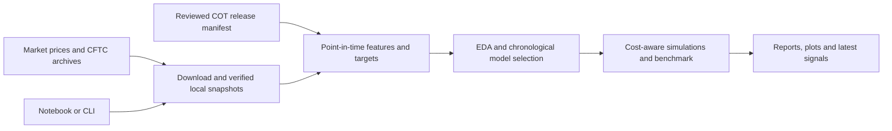
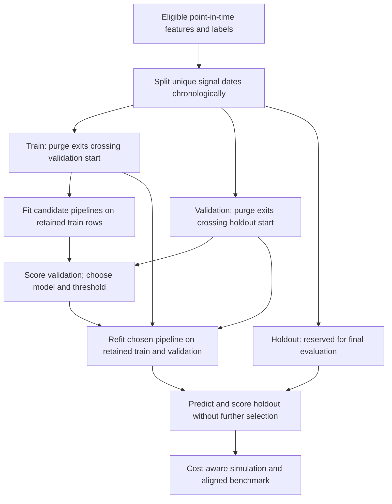
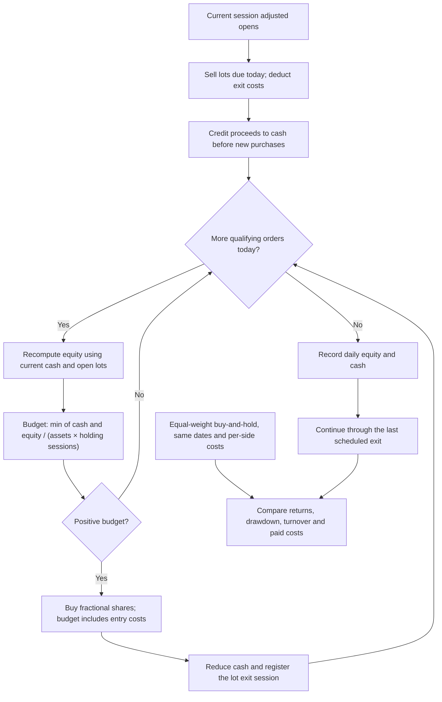

[EN](ARCHITECTURE.md) | [RU](ARCHITECTURE.ru.md)

# Architecture and data flow

The project is a local research workflow for five-trading-session GLD and SLV return forecasts. Other market series are explanatory inputs, not traded assets. The [frozen full-COT experiment](FULL_RUN.md) records an executed real-data run and exact numerical replay; the diagrams below explain the implementation rather than imply profitability.



The data eligibility and evaluation boundaries are shown separately below. A report's observation date cannot make it available to an earlier signal, and target intervals crossing a split are removed before selection or evaluation.



- `src/capstone/data.py` handles Yahoo Finance and Binance Spot market retrieval plus CFTC archives, with metadata and SHA-256 checksums. `data/` holds local data; repeated offline loads are read-only and deterministic for the same config, while an explicit refresh replaces snapshots. Preserve a copy to reproduce a particular input vintage.
- `src/capstone/features.py` aligns eligible information to NYSE sessions and builds features and the target. The COT release manifest is a manually reviewed input: a report date alone is not proof of public availability. See [publication evidence](COT_RELEASE_EVIDENCE.md).
- `src/capstone/modeling.py` provides chronological splitting, purging, candidate models and validation-based selection; `backtest.py` provides vectorized and cash-constrained simulations.
- `src/capstone/cli.py` coordinates stages and writes generated files to `artifacts/` by default; `notebooks/workflow.ipynb` orchestrates the same workflow. `.run/` is for local environment and caches. Generated data and outputs are excluded from Git.
- `config/config.yml` owns dates, source paths, target/market ticker maps and per-series provider selection; `config/settings.yml` owns freshness, provider timeouts, split, model search, trading, output and local session-audit settings. Ingestion activates the union of required targets and mapped market features, so removing an optional market from `market_features` disables both its download and model input. The YAML loader rejects duplicate top-level keys instead of silently overriding them. Credentials stay outside both files.

Signals use the ETF session close; the target uses adjusted opens from the next session to five sessions after entry. A completed crypto daily bar is eligible after its UTC day ends. Adjusted opens approximate total return and are not a dividend ledger. The frozen model for latest signals exposes its training-label cutoff. Current source revisions, COT vintage, modeled costs and simulated execution limit conclusions.

The reviewed manifest contains 218 evidenced COT report dates, including 216 dates from official PRE row metadata between 2022-10-04 and 2026-11-17. The stricter frozen experiment uses a separate audited manifest; its completed evaluation and limitations are recorded in [the full-run report](FULL_RUN.md). Broader manifest coverage does not automatically inherit the frozen audit checks. Refer to the [release evidence](COT_RELEASE_EVIDENCE.md) and [runbook](RUNBOOK.md).

## Signal and execution ordering

Availability is tested at the actual exchange close, including early closes. The five-session target starts at the next open, not at the signal price. Historical vendor adjustment and vintage limitations still apply.

```mermaid
sequenceDiagram
    participant SRC as Market and COT sources
    participant F as Feature builder
    participant M as Frozen model
    participant B as Event simulator
    SRC->>F: Only completed bars and evidenced COT known by signal time
    Note over F: Signal at actual NYSE session close
    F->>M: Eligible feature row; no future label as input
    M->>B: Prediction and validation-selected threshold
    Note over B: Enter at next session adjusted open
    B->>B: Hold for five ETF sessions
    Note over B: Exit at adjusted open; assess exit costs
```

## Cash-constrained simulation

This is the event simulator in `backtest.py`. The fixed-notional vector calculation is an approximation with different accounting; see the [full-run comparison](FULL_RUN.md#strategy-results).


