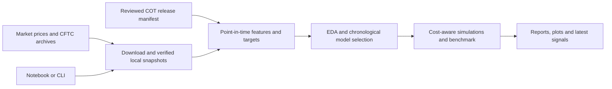

[EN](ARCHITECTURE.md) | [RU](ARCHITECTURE.ru.md)

# Architecture and data flow

The project is a local research workflow for five-trading-session GLD and SLV return forecasts. Other market series are explanatory inputs, not traded assets. This describes implemented components, not a verified end-to-end real-data run.

- `src/capstone/data.py` handles source retrieval and cached inputs with metadata and checksums. `data/` holds local data; refreshing a snapshot can replace it, so preserve a copy to reproduce a particular run.
- `src/capstone/features.py` aligns eligible information to NYSE sessions and builds features and the target. The COT release manifest is a manually reviewed input: a report date alone is not proof of public availability. See [publication evidence](COT_RELEASE_EVIDENCE.md).
- `src/capstone/modeling.py` provides chronological splitting, purging, candidate models and validation-based selection; `backtest.py` provides vectorized and cash-constrained simulations.
- `src/capstone/cli.py` coordinates stages and writes generated files to `artifacts/` by default; `notebooks/workflow.ipynb` orchestrates the same workflow. `.run/` is for local environment and caches. Generated data and outputs are excluded from Git.
- `config/config.yml` owns dates, source paths and the target/market ticker maps; `config/settings.yml` owns freshness, provider timeouts, split, model search, trading, output and local session-audit settings. Ingestion activates the union of required targets and mapped market features, so removing an optional market from `market_features` disables both its download and model input. The YAML loader rejects duplicate top-level keys instead of silently overriding them. Credentials stay outside both files.

Signals use the ETF session close; the target uses adjusted opens from the next session to five sessions after entry. A completed crypto daily bar is eligible after its UTC day ends. Adjusted opens approximate total return and are not a dividend ledger. The frozen model for latest signals exposes its training-label cutoff. Current source revisions, COT vintage, modeled costs and simulated execution limit conclusions.

Only four historical COT reports currently have documented release evidence, insufficient for the intended experiment. Real downloads, full workflow and financial results remain unverified; refer to the [runbook](RUNBOOK.md) before running.
