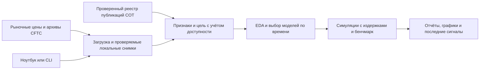
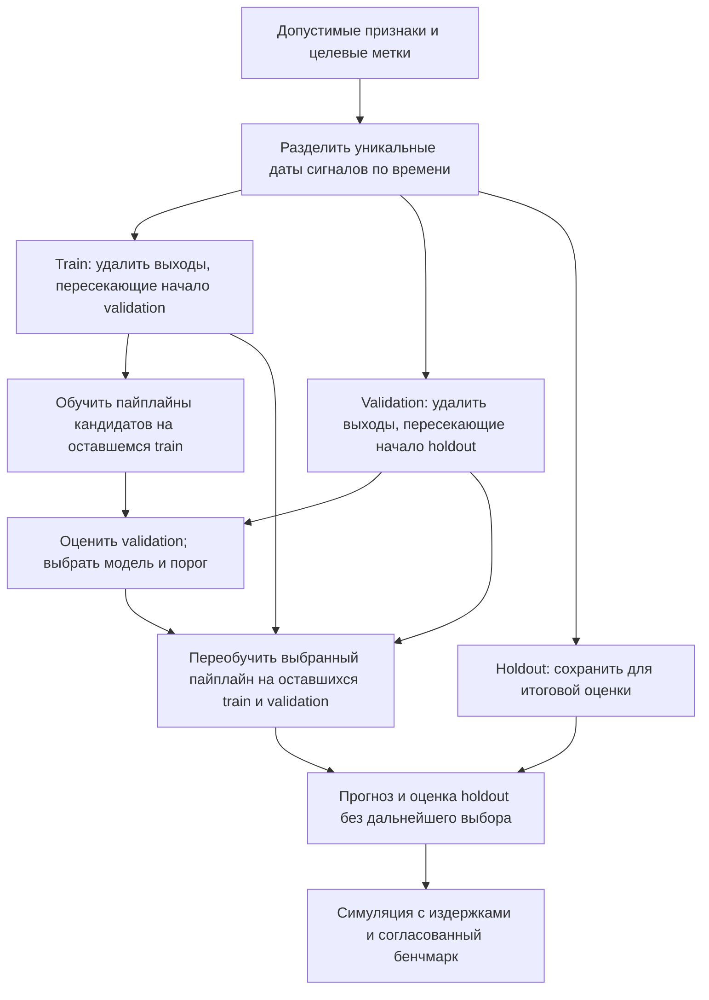
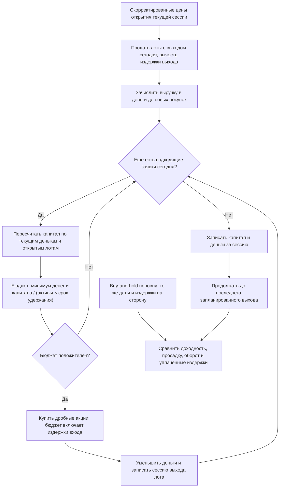

[EN](ARCHITECTURE.md) | [RU](ARCHITECTURE.ru.md)

# Архитектура и поток данных

Проект представляет собой локальный исследовательский workflow для прогноза доходности GLD и SLV на горизонте пяти торговых сессий. Другие рыночные ряды служат входными признаками, а не торгуемыми активами. В [отчёте полного эксперимента с COT](FULL_RUN.ru.md) зафиксированы реальный запуск и точный численный повтор; схемы ниже объясняют реализацию, а не предполагают прибыльность.



Ниже отдельно показаны границы доступности данных и оценки. Дата наблюдения отчёта не делает его доступным для более раннего сигнала; целевые интервалы, пересекающие границы выборок, удаляются до выбора модели и оценки.



- `src/capstone/data.py` загружает рыночные данные Yahoo Finance и Binance Spot, а также архивы CFTC; для входов сохраняются метаданные и SHA-256. Данные хранятся в `data/`; повторное офлайн-чтение только читает файлы и детерминировано при той же конфигурации, а явное обновление заменяет снимки. Для воспроизведения конкретной версии входов сохраните копию.
- `src/capstone/features.py` выравнивает доступную информацию по сессиям NYSE и строит признаки и цель. Реестр публикаций COT проверяется вручную: дата отчёта сама по себе не подтверждает публичную доступность. См. [подтверждения публикаций](COT_RELEASE_EVIDENCE.ru.md).
- `src/capstone/modeling.py` содержит разбиение по времени с исключением пересекающихся горизонтов, модели и выбор на validation; `backtest.py` реализует векторную и ограниченную капиталом симуляции.
- `src/capstone/cli.py` координирует этапы и по умолчанию записывает результаты в `artifacts/`; `notebooks/workflow.ipynb` запускает тот же workflow. `.run/` предназначен для локального окружения и кэшей. Загруженные данные и результаты исключены из Git.
- `config/config.yml` задаёт даты, пути к источникам, целевые тикеры, межрыночные ряды и поставщика для каждого ряда; `config/settings.yml` хранит параметры свежести, тайм-ауты поставщиков, разбиения, сетку моделей, торговли, выходных файлов и локального аудита сессий. Загрузчик активирует обязательные целевые ряды и перечисленные признаки; удаление необязательного ряда из `market_features` выключает и его загрузку, и модельный признак. YAML-загрузчик отклоняет совпадающие ключи верхнего уровня вместо неявного переопределения. Секреты в этих файлах не хранятся.

Сигнал формируется на закрытии сессии ETF; цель использует скорректированные цены открытия следующей сессии и открытия через пять сессий после входа. Завершённая дневная свеча криптовалюты доступна после окончания суток UTC. Скорректированные цены приближённо учитывают совокупную доходность, но не заменяют учёт дивидендов. Отчёт по последним сигналам показывает границу обучающих меток зафиксированной модели. Выводы ограничивают возможные пересмотры источников, версии данных COT, модель издержек и симулированное исполнение.

Проверенный реестр содержит 218 дат отчётов COT, включая 216 дат по официальным метаданным PRE за период 2022-10-04–2026-11-17. Более строгий замороженный эксперимент использует отдельный проверенный манифест; выполненная оценка и ограничения записаны в [отчёте полного запуска](FULL_RUN.ru.md). Более широкое покрытие общего реестра не означает автоматического прохождения проверок замороженного аудита. См. [свидетельства публикаций](COT_RELEASE_EVIDENCE.ru.md) и [инструкцию запуска](RUNBOOK.ru.md).

## Порядок сигнала и исполнения

Доступность проверяется на фактическом закрытии биржи, включая сокращённые сессии. Пятисессионная цель начинается на следующем открытии, а не по цене сигнала. Ограничения исторических корректировок и винтажей поставщика сохраняются.

```mermaid
sequenceDiagram
    participant SRC as Рыночные источники и COT
    participant F as Построение признаков
    participant M as Зафиксированная модель
    participant B as Событийная симуляция
    SRC->>F: Только завершённые бары и подтверждённый COT, известные к сигналу
    Note over F: Сигнал на фактическом закрытии сессии NYSE
    F->>M: Допустимая строка признаков; будущая цель не входит во входы
    M->>B: Прогноз и выбранный на validation порог
    Note over B: Вход на скорректированном открытии следующей сессии
    B->>B: Удержание в течение пяти сессий ETF
    Note over B: Выход на скорректированном открытии; учёт издержек выхода
```

## Симуляция с ограничением доступными деньгами

Это событийный симулятор из `backtest.py`. Векторный расчёт с фиксированным номиналом является приближением с другим учётом; см. [сравнение в полном запуске](FULL_RUN.ru.md#симуляции).


