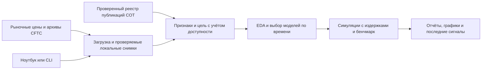

[EN](ARCHITECTURE.md) | [RU](ARCHITECTURE.ru.md)

# Архитектура и поток данных

Проект представляет собой локальный исследовательский workflow для прогноза доходности GLD и SLV на горизонте пяти торговых сессий. Другие рыночные ряды служат входными признаками, а не торгуемыми активами. Ниже описаны реализованные компоненты; полный запуск на реальных данных пока не подтверждён.

- `src/capstone/data.py` загружает источники и использует локальные входы с метаданными и контрольными суммами. Данные хранятся в `data/`; обновление может заменить снимок, поэтому для воспроизведения конкретного запуска сохраните его копию.
- `src/capstone/features.py` выравнивает доступную информацию по сессиям NYSE и строит признаки и цель. Реестр публикаций COT проверяется вручную: дата отчёта сама по себе не подтверждает публичную доступность. См. [подтверждения публикаций](COT_RELEASE_EVIDENCE.ru.md).
- `src/capstone/modeling.py` содержит разбиение по времени с исключением пересекающихся горизонтов, модели и выбор на validation; `backtest.py` реализует векторную и ограниченную капиталом симуляции.
- `src/capstone/cli.py` координирует этапы и по умолчанию записывает результаты в `artifacts/`; `notebooks/workflow.ipynb` запускает тот же workflow. `.run/` предназначен для локального окружения и кэшей. Загруженные данные и результаты исключены из Git.
- `config/config.yml` задаёт даты, пути к источникам, целевые тикеры и межрыночные ряды; `config/settings.yml` хранит параметры свежести, тайм-ауты поставщиков, разбиения, сетку моделей, торговли, выходных файлов и локального аудита сессий. Загрузчик активирует обязательные целевые ряды и перечисленные признаки; удаление необязательного ряда из `market_features` выключает и его загрузку, и модельный признак. YAML-загрузчик отклоняет совпадающие ключи верхнего уровня вместо неявного переопределения. Секреты в этих файлах не хранятся.

Сигнал формируется на закрытии сессии ETF; цель использует скорректированные цены открытия следующей сессии и открытия через пять сессий после входа. Завершённая дневная свеча криптовалюты доступна после окончания суток UTC. Скорректированные цены приближённо учитывают совокупную доходность, но не заменяют учёт дивидендов. Отчёт по последним сигналам показывает границу обучающих меток зафиксированной модели. Выводы ограничивают возможные пересмотры источников, версии данных COT, модель издержек и симулированное исполнение.

Сейчас подтверждена доступность только четырёх исторических отчётов COT — этого недостаточно для эксперимента. Реальная загрузка, полный workflow и финансовые результаты пока не подтверждены; перед запуском см. [инструкцию](RUNBOOK.ru.md).
