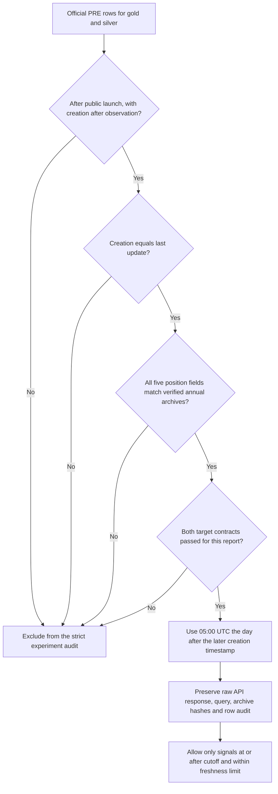

[EN](COT_RELEASE_EVIDENCE.md) | [RU](COT_RELEASE_EVIDENCE.ru.md)

# COT publication evidence

The project default manifest `config/release_dates.csv` contains **213 audited post-launch report dates** from 2022-10-25 through 2026-11-17; it is not a complete COT publication history. Each included date has paired gold/silver PRE rows, unchanged row metadata, and exact agreement with five modeled position fields in verified annual archives. This span supports the documented chronological split, subject to market-data checks. It does not establish any model or strategy result.

## Evidence and conservative timestamps

The CFTC's [historical special announcements](https://www.cftc.gov/MarketReports/CommitmentsofTraders/HistoricalSpecialAnnouncements/index.htm) document both a statement that the report is being issued **today** and its report date:

| Report date | Publication evidence | Conservative cutoff / status |
| --- | --- | --- |
| 2020-12-21 | CFTC notice confirms release | 2020-12-29 05:00 UTC; excluded from the post-launch model window |
| 2021-06-15 | Notice says “will instead be published”; no confirmation of actual release | Not included; no eligibility cutoff assigned |
| 2023-01-31 | 2023-02-24 | 2023-02-25 05:00 UTC |
| 2023-02-07 | 2023-03-03 | 2023-03-04 05:00 UTC |
| 2023-02-14 | 2023-03-08 | 2023-03-09 05:00 UTC |
| 2023-02-21 | 2023-03-10 | 2023-03-11 05:00 UTC |
| 2023-02-28 | 2023-03-14 | 2023-03-15 05:00 UTC |
| 2023-03-07 | 2023-03-16 | 2023-03-17 05:00 UTC |
| 2023-03-14 | 2023-03-21 | 2023-03-22 05:00 UTC |

The time in the manifest is a **conservative eligibility cutoff**, not an assertion of the actual release instant. These announcements do not specify the time. Using 05:00 UTC on the following day waits until at least midnight in US Eastern time, including daylight saving time. The manifest's existing column name `available_at` is therefore interpreted as "known available no later than this conservative time." The evidence is a CFTC same-day statement, not direct observation of a historical server log. Later revisions of archived positions are not ruled out.

The December 28, 2020 CFTC announcement explicitly says the December 21 report was published that day. It is retained as historical context but excluded from the default model manifest because it predates PRE and is an isolated pre-launch observation. The June 17, 2021 notice states that the June 15 report *would* instead be published June 21; the notice is not confirmation that publication occurred, so this date is excluded. The 2023 entries are cross-checked against same-day CFTC notices. The table is a sample of contemporaneous announcement evidence; the production manifest uses only the stricter audit described below.

## Official API evidence and coverage

The [CFTC PRE](https://www.cftc.gov/MarketReports/CommitmentsofTraders/index.htm) exposes its official **Disaggregated - Futures Only** dataset through the public [Socrata API](https://publicreporting.cftc.gov/resource/72hh-3qpy.json). The manifest contains a date-specific query URL for each report, selecting `report_date_as_yyyy_mm_dd`, Socrata's `:created_at` system field, and CFTC contract codes `088691` (COMEX gold) and `084691` (COMEX silver). [Socrata documents `:created_at` as the timestamp when a record was created](https://dev.socrata.com/docs/system-fields).

The broader query on 2026-11-21 returned 216 report dates from 2022-10-04 through 2026-11-17. The three dates 2022-10-04, 2022-10-11 and 2022-10-18 are before the PRE public launch and are excluded even though rows appeared in the later API. The strict audit query starts at 2022-10-21 and returned **213 paired report dates** (426 contract rows). Both target rows are present for each included date, with equal `:created_at` and `:updated_at`, and the five modeled position fields exactly match verified annual archives. Bulk-import/prelaunch records, changed rows, archive mismatches and incomplete pairs are excluded. The observed creation dates match the contemporaneous CFTC 2023 issuance notices for overlapping reports and realized catch-up dates where cross-checked; this supports PRE `:created_at` as post-launch, report-specific API availability evidence.

For each PRE record, `available_at` is set to 05:00 UTC on the calendar day after the `:created_at` date. This deliberately conservative eligibility cutoff is later than the recorded API row-creation time; it is not an assertion that the report first became available at that exact cutoff. The PRE reports use the same source data as the traditional CFTC reports. Current API metadata is not a preserved historical snapshot, so a later provider migration or replacement could change system timestamps; retain the row-level query links and the retrieval date when reproducing this evidence.

The strict audit is the source for the checked-in default manifest. Its decision path is:

This is a conservative API availability policy, not a reconstruction of the original static-report publication instant or historical HTTP access logs.

## Missing coverage and limitations

- The [CFTC historical archive](https://www.cftc.gov/MarketReports/CommitmentsofTraders/HistoricalViewable/index.htm) explicitly labels its displayed dates as report dates, not release dates. It does not by itself substantiate publication timing.
- CFTC's [COT FAQ](https://www.cftc.gov/MarketReports/CommitmentsofTraders/index.htm) says there is no historical list of release dates beyond the reports published on the Commission's website for the most recent 13 months. This limits how far the manifest can be expanded from official records alone.
- The CFTC [release schedule](https://www.cftc.gov/MarketReports/CommitmentsofTraders/ReleaseSchedule/index.htm) says the schedule is tentative and holidays may delay release. Do not treat a planned publication as an actual historical release; use the PRE row timestamp for the included 2022-2026 records.
- The December 2025 special-announcement table describes intended catch-up dates and a previous schedule was revised. PRE row-creation timestamps provide a retrospective actual-record check for the included catch-up reports; the schedule alone was not used to populate them.
- The 2023 release-date mapping uses the CFTC's stated normal relationship between a Friday publication and the preceding Tuesday observation date for these three otherwise ordinary weeks. Do not generalize that mapping to holiday or disrupted weeks without report-specific evidence.
- CFTC's October 2026 [announcement](https://www.cftc.gov/PressRoom/PressReleases/9316-26) describes a future twice-weekly release plan. Do not assume the former weekly timetable after a transition without verified evidence.
- The public position archive may contain subsequent corrections. A confirmed release date does not verify that today's downloaded position values reproduce the values originally published. The project must disclose this vintage limitation.

## Source and timing contract reviewed 2026-11-21

- **COT observation and release are separate facts.** The report's Tuesday `report_date` is the position observation date. The CFTC release schedule says reports are ordinarily published at 3:30 p.m. Eastern and usually cover the previous Tuesday, but it is tentative and federal holidays can delay publication by one or two days. The historical archive exposes report dates and annual report files; it does not provide a complete per-report release log. A schedule entry or weekday pattern is not evidence that a particular report was actually public at that time.
- **Selected COT scope.** The CFTC's [Historical Compressed archive](https://www.cftc.gov/MarketReports/CommitmentsofTraders/HistoricalCompressed/index.htm) lists annual Disaggregated Futures Only reports from September 2009, in text and Excel formats. The project intends to use COMEX gold and silver market rows and fields for open interest and trader positions. Validate report type, market identity, CFTC market code, report date, numeric fields, duplicates and missing rows against the downloaded file before ingestion. Archive availability is not release-time or vintage evidence. No license conclusion beyond the public availability of the reports was verified in this review; preserve source attribution and recheck applicable provider notices before redistribution.
- **COT eligibility.** A report-date/publication-date pair may enter `config/release_dates.csv` when supported either by an explicit contemporaneous CFTC notice or, from the PRE launch onward, by report-specific official API `:created_at` metadata corroborated against contemporaneous notices where available. Do not treat planned schedules, archive observation dates, or pre-launch bulk-import timestamps as historical publication evidence. For PRE rows, the following-day 05:00 UTC timestamp is a conservative cutoff after the recorded creation date, not the observed release instant. Join only when `available_at <= signal_at`; report any missing or ambiguous coverage. CFTC announced in October 2026 a plan to move to twice-weekly publication; validate the actual transition from PRE row metadata before interpreting post-transition reports.
- **ETF and other market bars.** NYSE publishes a core session of 9:30 a.m.–4:00 p.m. Eastern and early-close/holiday calendars. The feature signal is timestamped at the actual GLD/SLV session close using the exchange calendar; a daily bar for that session is eligible only after that close. Snapshot request-start metadata prevents a bar still forming when requested from later being treated as complete during offline replay. Yahoo/yfinance history is a retrieved vendor series, not a point-in-time archive: provider adjustments and revisions may reflect later information. The yfinance documentation says it is unaffiliated with Yahoo, points users to Yahoo's terms, and describes the service as intended for personal use; this project has not independently established commercial redistribution rights, a formal service-level agreement, or numeric rate limits. Keep raw files local and recheck current terms before wider use.
- **Optional series and failure behavior.** BTC and NVDA are required under current configuration; SOL, ETH, ZEC, S&P 500, Nasdaq and Dow inputs are optional. Each optional input must retain its own source, retrieval, timestamp and failure metadata. Missing optional series must not silently change the required target universe; mark their feature values missing or explicitly disable them through configuration. FRED remains out of scope until historical vintages and release availability are established. No provider response, agreement on data rights, download, or numeric rate limit was verified by this review.

The audit query response and row-by-row archive comparison are preserved in the ignored local bundle `artifacts/cot-publication-audit-20261121-retry/`; its manifest hash is `694c02fb29237f0314815d6e1191ca8e136d3cc15b3e8a0409421d7cac293235`, the same as `config/release_dates.csv`. Preserve this query output or another dated snapshot of `:created_at` values if the provider migrates the dataset. Expand the model window before 2022-10 only if sufficient report-specific publication evidence becomes available. The third-party [ZipLime methodology](https://huggingface.co/datasets/ZipLime/commitments-of-traders/blob/main/PIPELINE.md) remains a lead, not ground truth.

Checked 2026-11-21 using the official CFTC PRE API and CFTC, Socrata, NYSE and yfinance documentation. The strict query froze 426 rows as 213 eligible paired report dates; both contracts' metadata and five fields were compared with annual archives. The checked-in default manifest now uses exactly these 213 dates and has SHA-256 `694c02fb29237f0314815d6e1191ca8e136d3cc15b3e8a0409421d7cac293235`. The CFTC does not publish a complete historical release-date list; usable multi-year evidence begins in October 2022. Provider smoke and local market-snapshot validation are separate checks. Yahoo's terms and redistribution rights remain unverified.
