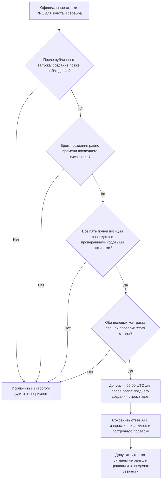

[EN](COT_RELEASE_EVIDENCE.md) | [RU](COT_RELEASE_EVIDENCE.ru.md)

# Подтверждения публикаций COT

Основной `config/release_dates.csv` содержит **213 проверенных post-launch дат отчётов** с 2022-10-25 по 2026-11-17; это не полная история COT. Для каждой даты есть парные строки золота и серебра PRE, неизменённые системные timestamps и точное совпадение пяти моделируемых полей позиций с годовыми архивами. Этот период поддерживает хронологическое разбиение при условии корректности рыночных данных. Он не подтверждает результаты модели или стратегии.

## Доказательства и консервативные временные границы

В [архиве специальных объявлений CFTC](https://www.cftc.gov/MarketReports/CommitmentsofTraders/HistoricalSpecialAnnouncements/index.htm) указано, что соответствующий отчёт выпускается **сегодня**, а также указана дата отчёта:

| Дата отчёта | Свидетельство о публикации | Консервативный cutoff / статус |
| --- | --- | --- |
| 2020-12-21 | Объявление CFTC подтверждает публикацию | 2020-12-29 05:00 UTC; исключено из post-launch окна модели |
| 2021-06-15 | В уведомлении сказано «будет опубликован»; подтверждения фактического выпуска нет | Не включено; cutoff не назначался |
| 2023-01-31 | 2023-02-24 | 2023-02-25 05:00 UTC |
| 2023-02-07 | 2023-03-03 | 2023-03-04 05:00 UTC |
| 2023-02-14 | 2023-03-08 | 2023-03-09 05:00 UTC |
| 2023-02-21 | 2023-03-10 | 2023-03-11 05:00 UTC |
| 2023-02-28 | 2023-03-14 | 2023-03-15 05:00 UTC |
| 2023-03-07 | 2023-03-16 | 2023-03-17 05:00 UTC |
| 2023-03-14 | 2023-03-21 | 2023-03-22 05:00 UTC |

Время в реестре — **консервативная граница допустимого использования**, а не утверждение о фактическом моменте публикации: в объявлениях время не указано. Значение 05:00 UTC следующего дня наступает не ранее полуночи по восточному времени США, в том числе при переходе на летнее время. Поэтому имя столбца `available_at` здесь означает «известно, что данные были доступны не позднее этой консервативной границы». Основание — заявление CFTC в день публикации, а не непосредственное наблюдение исторического журнала сервера. Последующие исправления архивных позиций не исключены.

Объявление от 28 декабря 2020 года подтверждает публикацию отчёта от 21 декабря. Запись сохранена как исторический контекст, но исключена из основной модельной выборки: она предшествует PRE и представляет единичный случай до запуска API. Уведомление от 17 июня 2021 года говорит, что отчёт от 15 июня планируется опубликовать 21 июня; подтверждения фактической публикации нет, поэтому дата исключена. Семь строк 2023 года выборочно сверены с объявлениями CFTC; основной manifest использует строгий аудит ниже.

## Официальный API и покрытие

[PRE CFTC](https://www.cftc.gov/MarketReports/CommitmentsofTraders/index.htm) предоставляет официальный набор **Disaggregated - Futures Only** через [публичный Socrata API](https://publicreporting.cftc.gov/resource/72hh-3qpy.json). Для каждой даты ссылка в реестре задаёт запрос полей `report_date_as_yyyy_mm_dd`, системного поля Socrata `:created_at` и кодов CFTC `088691` (золото COMEX) и `084691` (серебро COMEX). [Документация Socrata](https://dev.socrata.com/docs/system-fields) определяет `:created_at` как время создания записи.

Более широкий запрос от 2026-11-21 вернул 216 дат отчётов с 2022-10-04 по 2026-11-17. Три даты — 2022-10-04, 2022-10-11 и 2022-10-18 — предшествуют публичному запуску PRE и исключены, даже если строки позже появились в API. Строгий запрос начинается с 2022-10-21 и вернул **213 парных дат отчётов** (426 строк). Для каждой включённой даты присутствуют оба целевых контракта; `:created_at` равен `:updated_at`; пять моделируемых полей совпадают с проверенными годовыми архивами. Массовые записи до запуска PRE, изменённые записи, несовпадения с архивом и неполные пары исключены. Эти метаданные `:created_at` используются как свидетельство доступности конкретной записи после запуска PRE.

Для каждой PRE-записи в `available_at` указано 05:00 UTC на следующий календарный день после даты `:created_at`. Это консервативная граница после времени создания записи, а не утверждение о точном времени публикации. PRE передаёт те же исходные данные, что и традиционные отчёты CFTC. Текущие метаданные API не являются архивным снимком: миграция или замена набора поставщиком может изменить системные временные метки. Для воспроизводимости сохраняйте запросы по строкам и дату получения доказательств.

Строгий аудит является источником основного манифеста проекта. Последовательность проверок:

Это консервативная политика доступности API, а не восстановление точного момента исходной статической публикации или исторических журналов HTTP-доступа.

## Недостаточное покрытие и ограничения

- [Исторический архив CFTC](https://www.cftc.gov/MarketReports/CommitmentsofTraders/HistoricalViewable/index.htm) прямо указывает, что отображает даты отчётов, а не публикаций. Сам по себе он не подтверждает время публикации.
- В [FAQ CFTC о COT](https://www.cftc.gov/MarketReports/CommitmentsofTraders/index.htm) сказано, что полного исторического списка дат публикаций нет; на сайте доступны отчёты за последние 13 месяцев. PRE даёт полезный многолетний интервал с октября 2022 года, но не решает вопрос о публикациях до запуска набора.
- [График публикаций CFTC](https://www.cftc.gov/MarketReports/CommitmentsofTraders/ReleaseSchedule/index.htm) предварительный; праздники могут вызывать задержки. Плановую дату нельзя считать доказательством фактического исторического выпуска.
- Таблица специального объявления за декабрь 2025 года описывает *планировавшиеся* даты наверстывания; предыдущий график был пересмотрен. Без отдельного ретроспективного доказательства публикации эти записи исключены.
- Сопоставление дат 2023 года использует заявленную CFTC обычную связь «публикация в пятницу — наблюдение во вторник» для этих трёх недель без праздников. Не переносите её на праздничные или иные недели со сбоем без отдельного свидетельства.
- [Объявление CFTC](https://www.cftc.gov/PressRoom/PressReleases/9316-26) за октябрь 2026 года описывает будущий переход на две публикации в неделю. Нельзя предполагать сохранение прежнего недельного графика после перехода без подтверждения.
- Публичный архив позиций может содержать последующие исправления. Подтверждение даты выпуска не доказывает, что скачанные сегодня значения совпадают с первоначально опубликованными. Ограничение, связанное с версией данных, необходимо раскрывать.

## Контракт источников и времени (проверен 2026-11-21)

- **Дата наблюдения COT и выпуск — разные факты.** `report_date` — дата наблюдения позиций во вторник. По расписанию CFTC публикация обычно происходит в 15:30 по восточному времени и обычно содержит данные за предыдущий вторник, однако расписание предварительное, а федеральные праздники могут задержать выпуск на один-два дня. В историческом архиве есть даты отчётов и годовые файлы, но нет полного журнала фактических публикаций по каждому отчёту. Запись в расписании или обычный день недели не подтверждают, что конкретный отчёт действительно был опубликован в это время.
- **Выбранный охват COT.** В [сжатом историческом архиве CFTC](https://www.cftc.gov/MarketReports/CommitmentsofTraders/HistoricalCompressed/index.htm) перечислены годовые отчёты Disaggregated Futures Only с сентября 2009 года в текстовом формате и Excel. Проект предполагает использовать строки рынков COMEX по золоту и серебру, открытый интерес и позиции участников. Перед загрузкой следует проверить тип отчёта, идентичность рынка и код CFTC, дату отчёта, числовые поля, дубликаты и пропущенные строки. Наличие файла в архиве не подтверждает время публикации или исходную редакцию данных. В этой проверке не установлены условия лицензии сверх факта публичной доступности отчётов; сохраняйте атрибуцию и проверяйте условия поставщика до распространения данных.
- **Допуск COT.** Пару «дата отчёта — время создания» можно включать в `config/release_dates.csv`, если её подтверждает объявление CFTC, называющее отчёт, либо, начиная с запуска PRE, официальные построчные метаданные `:created_at` с проверкой обоих используемых контрактов и сопоставлением с объявлениями, где они доступны. Не используйте метки пакетной загрузки до запуска PRE как даты публикации. Для PRE 05:00 UTC на следующий календарный день после создания — консервативная граница, а не наблюдаемый момент выпуска. Объединяйте отчёт только при `available_at <= signal_at`; пробелы или неоднозначности покрытия отражайте явно. Перед интерпретацией выпусков после объявленного CFTC в октябре 2026 года плана перейти на два выпуска в неделю проверьте фактический переход и метаданные PRE.
- **Биржевые и другие рыночные свечи.** NYSE указывает основную сессию с 9:30 до 16:00 по восточному времени и публикует календари праздников и сокращённых сессий. Сигнал по GLD/SLV получает отметку фактического закрытия сессии по биржевому календарю; дневная свеча этой сессии допустима только после закрытия. Метаданные начала запроса снимка не позволяют при офлайн-повторе считать завершённой свечу, которая ещё формировалась в момент запроса. История Yahoo/yfinance — загруженный ряд поставщика, а не архив «как было известно тогда»: корректировки и обновления могут отражать более позднюю информацию. Документация yfinance указывает, что инструмент не связан с Yahoo, отсылает к условиям Yahoo и описывает сервис как предназначенный для личного использования. Проект отдельно не установил права на коммерческое распространение, формальное соглашение об уровне сервиса или числовые лимиты запросов. Храните исходные файлы локально и проверяйте актуальные условия до более широкого использования.
- **Необязательные ряды и сбои.** В текущей конфигурации BTC и NVDA обязательны; SOL, ETH, ZEC, S&P 500, Nasdaq и Dow необязательны. Для каждого ряда сохраняются отдельные источник, время получения, временные метки и сведения об ошибках. Отсутствие необязательного ряда не должно незаметно менять обязательную целевую вселенную: оставляйте значения признака пропущенными либо явно отключайте источник через конфигурацию. FRED остаётся вне охвата, пока не подтверждены исторические редакции и время публикаций. Эта проверка не подтвердила ответы поставщиков, условия использования данных, факт загрузки или числовые лимиты запросов.

Ответ строгого API-запроса и построчная сверка с архивом сохранены в игнорируемом bundle `artifacts/cot-publication-audit-20261121-retry/`; хэш манифеста совпадает с `config/release_dates.csv`. Сохраните датированный ответ или другой архив `:created_at` на случай миграции поставщика. Расширяйте модельный период до октября 2022 года только при наличии достаточных свидетельств публикации каждого отчёта. Сторонняя [методология ZipLime](https://huggingface.co/datasets/Commitment-of-Traders) остаётся гипотезой, не источником истины.

Проверено 2026-11-21 по PRE API и документам CFTC, Socrata, NYSE и yfinance. Строгий запрос зафиксировал 426 строк в 213 допустимых парных дат; оба контракта сверены по системным метаданным и пяти полям с годовыми архивами. Основной manifest содержит ровно эти 213 дат; его SHA-256: `694c02fb29237f0314815d6e1191ca8e136d3cc15b3e8a0409421d7cac293235`. Полного исторического списка выпусков у CFTC нет; пригодное многолетнее окно начинается в октябре 2022 года. Smoke-проверки источников и локальных рыночных снимков — отдельные проверки. Права на распространение данных Yahoo не подтверждены.
