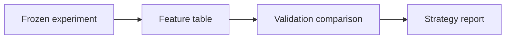

[EN](ORCHESTRATION.md) | [RU](ORCHESTRATION.ru.md)

# Optional local Dagster orchestration

Dagster provides a local run history and asset view around the existing frozen research runner. Install it after the [research notebook and dashboard](RESEARCH_EXPLORER.md) when execution visibility is useful. The original CLI remains the research implementation.

```sh
make setup-orchestration
just dagster-check
make dagster
```

The UI listens at `http://127.0.0.1:3000`. Stop it with Ctrl+C. State and run logs are kept under ignored `.run/dagster/`; a new instance copies the telemetry-disabled `config/dagster.yaml` without replacing existing user configuration. No persistent service or schedule is installed. `dg` explicitly uses the project command's `.run/venv`, even if a legacy `.venv` also exists.

## Execute a research run

Launch `frozen_research_job` in the UI or from the project root:

```sh
just dagster-run
```

Launch settings live in `config/dagster-run.yml`: source configuration, research settings and output root. To use another configuration, create a local YAML override and pass its filename:

```sh
just dagster-run .run/my-dagster-run.yml
```

Each Dagster run writes to `artifacts/dagster/<run-id>/` and its execution log beside that directory. Saved bundles are never overwritten; launch a new Dagster run after a failed attempt. The standard runner first freezes inputs, checks adequate point-in-time COT coverage, executes twice offline and checks numerical equality. A blocked or failed experiment fails the Dagster run before successful materializations are emitted.



These four related assets come from **one atomic multi-asset computation**. The diagram shows artifact lineage; it does not promise independently retriable training or simulation stages. Splitting the freeze/replay transaction would change its acceptance contract and is outside this adapter.

Asset metadata exposes bundle paths, feature/coverage counts, validation-selected model and portfolio metrics. Dagster never chooses models or thresholds itself. Source retrieval remains an explicit separate command; this job uses existing verified snapshots and does not refresh them or certify current signals.

To view an orchestrated bundle in Streamlit, set its exact path:

```sh
CAPSTONE_RESEARCH_RUN=artifacts/dagster/REPLACE_WITH_RUN_ID make dashboard
```

The dashboard's automatic picker searches direct children of `artifacts/`; nested Dagster bundles require this explicit selection.

## Verify and extend

```sh
uv run --locked --no-sync python -m pytest -q tests/integration/test_orchestration.py
```

Tests use fictional saved results and check one runner invocation, four asset materializations and a blocked run producing no successful assets. The optional test module skips when Dagster is absent. Use `just dagster-check` to validate definitions and a real cached-data materialization to verify actual execution separately.

Scheduling, fresh-data inference, deployment and dlt ingestion are separate follow-on work. A schedule requires a defined update cadence, source freshness checks and recovery policy; an incremental loader additionally requires a destination, cursor, stable keys and historical-revision handling. This adapter does not claim those criteria.
