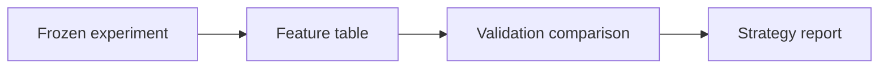

[EN](ORCHESTRATION.md) | [RU](ORCHESTRATION.ru.md)

# Локальная оркестрация через Dagster

Dagster добавляет историю запусков и просмотр assets к существующему frozen research runner. Устанавливайте его после [исследовательского notebook и dashboard](RESEARCH_EXPLORER.ru.md), когда нужно наблюдать за выполнением. Исследовательская реализация остаётся в исходном CLI.

```sh
make setup-orchestration
just dagster-check
make dagster
```

UI доступен на `http://127.0.0.1:3000`. Остановка — Ctrl+C. Состояние и журналы хранятся в игнорируемой `.run/dagster/`. При первой инициализации копируется `config/dagster.yaml` с отключённой telemetry; существующая пользовательская конфигурация не заменяется. Постоянный сервис и расписание не устанавливаются. `dg` явно использует `.run/venv` команды проекта, даже если осталась другая `.venv`.

## Запустить исследование

Запустите `frozen_research_job` в UI или из корня проекта:

```sh
just dagster-run
```

Параметры запуска находятся в `config/dagster-run.yml`: source config, research settings и каталог результатов. Для другой конфигурации создайте локальный YAML и передайте его имя:

```sh
just dagster-run .run/my-dagster-run.yml
```

Каждый Dagster run пишет в `artifacts/dagster/<run-id>/`; журнал выполнения сохраняется рядом. Существующие bundle не перезаписываются; после ошибки запускайте новый Dagster run. Стандартный runner замораживает inputs, проверяет достаточное point-in-time покрытие COT, выполняет два офлайн-расчёта и сравнивает численные outputs. Заблокированный или ошибочный эксперимент завершает Dagster run с ошибкой до выдачи успешных materializations.



Четыре связанных assets получаются из **одного атомарного multi-asset вычисления**. Диаграмма показывает происхождение результатов; независимый retry обучения или симуляции не реализован. Разделение транзакции freeze/replay изменило бы её acceptance contract и не входит в этот адаптер.

Метаданные показывают пути bundle, размеры таблицы и покрытия, выбранную на validation модель и метрики портфеля. Dagster сам не выбирает модель или порог. Получение данных остаётся отдельной явной командой; этот job использует проверенные локальные снимки, не обновляет их и не подтверждает актуальность сигналов.

Чтобы открыть результат оркестрированного запуска в Streamlit, укажите точный путь:

```sh
CAPSTONE_RESEARCH_RUN=artifacts/dagster/REPLACE_WITH_RUN_ID make dashboard
```

Автоматический поиск dashboard просматривает непосредственные дочерние каталоги `artifacts/`; вложенные Dagster bundle требуют явного выбора.

## Проверка и дальнейшее развитие

```sh
uv run --locked --no-sync python -m pytest -q tests/integration/test_orchestration.py
```

Тесты используют вымышленные результаты: проверяют один вызов runner, четыре materializations и отсутствие успешных assets при блокировке. Дополнительный модуль тестов пропускается без Dagster. `just dagster-check` проверяет definitions; реальный запуск на локальных снимках отдельно подтверждает выполнение исследования.

Расписание, прогноз по свежим данным, deployment и загрузка через dlt остаются отдельными следующими задачами. Для расписания нужны cadence обновлений, проверки свежести и recovery policy; для incremental loader — destination, cursor, стабильные ключи и правила исторических исправлений. Этот адаптер не заявляет выполнение этих критериев.
