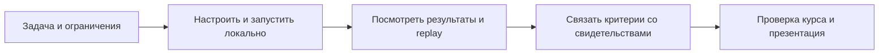

[EN](../README.md) | **RU**

# Прогнозирование ETF на драгоценные металлы с позициями CFTC

Проект исследует, помогают ли позиции участников фьючерсного рынка из отчётов CFTC и история рынка прогнозировать доходность GLD и SLV на следующих пяти торговых сессиях, и сравнивает гипотетические сигналы с пассивным владением ETF. Это учебное исследование, а не инвестиционная рекомендация.

## Текущие подтверждения

Программный конвейер и офлайн-демонстрация на синтетических данных готовы. В каноническом замороженном эксперименте с COT использованы 213 пар дат CFTC PRE после запуска, сверенные с годовыми архивами. Пакет текущего кода рассчитан дважды; совпали 20 числовых outputs, на validation выбрана базовая модель среднего (MAE 0,036398). Ранние корневые outputs с `forest_3` использовали сигналы до запуска CFTC PRE и не имели замороженных свидетельств кода/конфигурации/входов, поэтому исключены из отчёта; текущие корневые outputs теперь совпадают с каноническим прогоном. Стратегия long/cash и равновзвешенный buy-and-hold дали отрицательный результат на holdout после учтённых издержек. Это исторические результаты, не свидетельство будущей прибыльности. См. [отчёт эксперимента](FULL_RUN.ru.md) и [независимый QA](FINAL_QA.ru.md).

## Маршрут для проверяющего



1. Прочитайте [задачу и метод](../README.md#precious-metals-etf-forecasting-with-cftc-positioning) и [ограничения данных и времени](../README.md#method-and-limits).
2. Выполните команды из раздела [локального запуска](#локальный-запуск). Для точного повтора сохранённого эксперимента используйте команду replay из [отчёта полного запуска](FULL_RUN.ru.md): она читает локальные снимки и не загружает замену.
3. Сопоставьте [результаты отчёта](FULL_RUN.ru.md) с [независимыми QA-выводами](FINAL_QA.ru.md). В отчёте указаны канонический пакет, выбранный baseline, holdout-результаты и ограничения.
4. Откройте [матрицу критериев курса](COURSE_CRITERIA_STATUS.ru.md), чтобы перейти от каждого пункта рубрики к его свидетельствам и пробелам. Это учёт реализации, а не присуждённые курсом баллы.

| Этап | Результат | Свидетельства | Повторить |
|---|---|---|---|
| Эксперимент с COT | Канонический пакет использовал 1 916 строк и выбрал `mean` по MAE на validation. Два расчёта текущего кода совпали по 20 числовым outputs; long/cash и равновзвешенный buy-and-hold дали убыток после учтённых издержек. Ранние outputs без подтверждённого происхождения исключены и заменены актуальными. | [Отчёт полного запуска](FULL_RUN.ru.md), [независимый QA](FINAL_QA.ru.md) | команда replay сохранённого пакета приведена в отчёте |
| Синтетическая демонстрация workflow | Детерминированные вымышленные данные запускают код признаков, моделей и симуляции. Метрики демо не являются рыночными свидетельствами. | [Инструкция к демо](SYNTHETIC_DEMO.ru.md) | `make demo-synthetic` |

## Локальный запуск

Нужны Python 3.11+, `uv` и доступ к сети для установки и загрузки данных. Выполняйте команды из корня проекта:

```sh
make setup
make download        # использует проверенные снимки; загружает отсутствующее/устаревшее
make download-refresh # явно обновляет все настроенные источники
# сначала проверьте и дополните config/release_dates.csv подтверждениями публикаций
make run              # офлайн-конвейер по локальным снимкам
make run-notebook     # открыть workflow в Jupyter
make demo-synthetic   # офлайн-демонстрация на вымышленных данных
make test
```

Полный реальный запуск и offline replay выполнены на отдельном замороженном наборе; это подтверждает один исторический эксперимент, но не прибыльность или полную историю COT. Обычный `make run` использует настроенный манифест, который может содержать другую историю; точный повтор выполняется командами из [отчёта запуска](FULL_RUN.ru.md). Чистая установка и запуск Jupyter kernel требуют повторной проверки вне сетевых ограничений среды; см. [финальный QA](FINAL_QA.ru.md).

## Метод и ограничения

Сигнал формируется при фактическом закрытии сессии NYSE; вход моделируется на следующем открытии, а целевая доходность охватывает пять сессий ETF. Отчёт COT доступен модели только после подтверждённой даты публикации. Модели и пороги стратегий выбираются на хронологической validation-выборке; пересекающие границы целевые интервалы исключаются, а holdout используется только для итоговой оценки. Симуляции учитывают заданные издержки и сравниваются с buy-and-hold за тот же период.

Ключевые ограничения: API-метаданные не являются историческим журналом доступа; неизвестны винтажи данных; скорректированные цены и исполнение моделируются приближённо; рассматриваются только GLD и SLV; стратегия убыточна на holdout. Вклад COT отдельно через ablation не измерен. Подробнее — [архитектура](ARCHITECTURE.ru.md), [критерии курса](COURSE_CRITERIA_STATUS.ru.md) и [финальный QA](FINAL_QA.ru.md).

## Документация

Начните с [указателя документации](index.ru.md): там собраны практические инструкции, объяснения, справка по источникам и критерии курса. Планы проекта и операции агентов находятся в [`.ai/`](../.ai/IMPLEMENTATION_PLAN.md).
