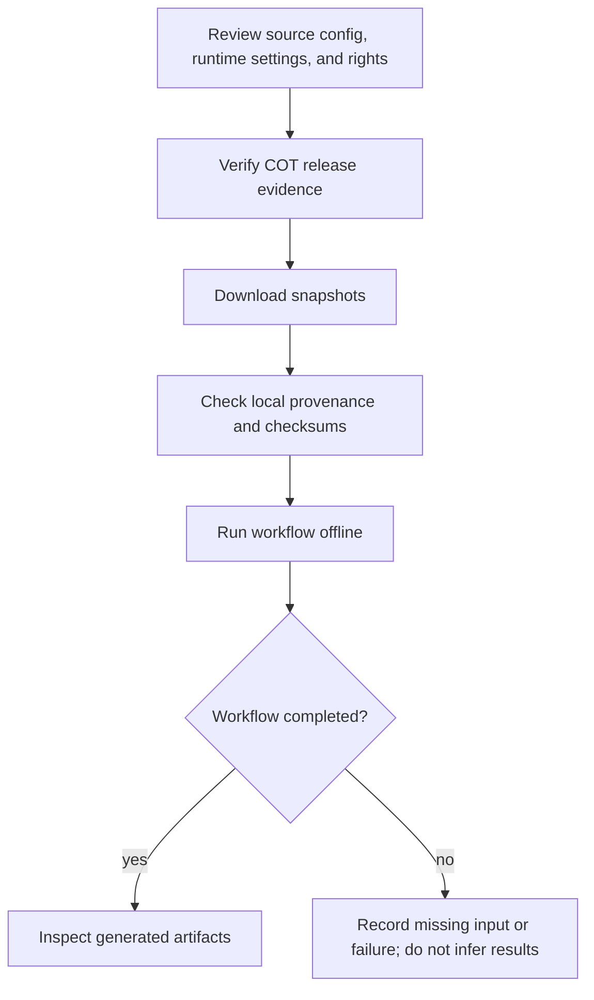
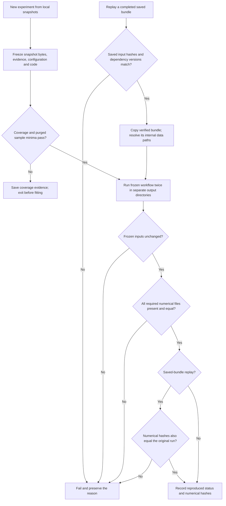
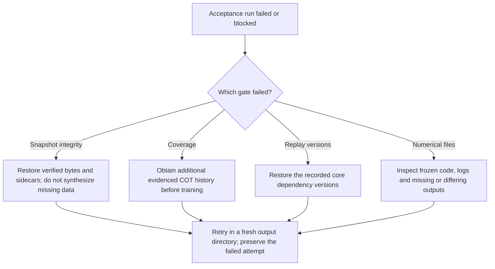

[EN](RUNBOOK.md) | [RU](RUNBOOK.ru.md)

# Local research runbook

A frozen full-COT run and offline repeat have completed; see the [executed experiment](FULL_RUN.md) for its exact inputs, commands, hashes and limitations. A new dataset must still pass availability and coverage checks. Partial files alone do not prove successful reproduction or profitability.

## Prerequisites

Use Python 3.11+, `uv`, network access to package and data providers, and sufficient disk space. Run commands from the project root. Downloaded data and generated outputs are local and excluded from Git; do not put credentials in files or history. The lockfile exists, but installation with all development extras in a clean environment remains unverified.

```bash
export UV_PROJECT_ENVIRONMENT=.run/venv UV_CACHE_DIR=.run/uv-cache
uv sync --locked --extra dev
```

## Download and reproduce



The decision step is evidence-based: only inspect research outputs as results after the full run succeeds. Fixture tests and partial downloads do not establish a completed experiment.

1. Review [`config/config.yml`](../config/config.yml), [`config/settings.yml`](../config/settings.yml), and the source rights and limitations in the [root README](../README.md).
2. Add enough independently evidenced report/publication pairs to `config/release_dates.csv`. Each row needs `report_date,available_at,source_url`; use explicit UTC and an HTTPS evidence link. Check holidays and exceptional delays. Do not use observation dates or planned schedules as evidence of release. Preserve a record of evidence and consider historical revisions.
3. Download source snapshots:

   ```bash
   uv run capstone download --config config/config.yml --settings config/settings.yml
   ```

   The default is cache-aware and repeatable: checksum-valid, correctly sourced, complete snapshots are skipped. Current-year CFTC cache freshness uses `download_cache_ttl_hours` from `config/settings.yml` (24 hours by default); validated historical archives are reused. Use `make download-refresh` or add `--force` to the CLI command to explicitly refresh every configured source. Logs show per-source cache decisions, validation failures, downloaded row/date coverage, SHA-256, and a final count summary. A failed response is validated before writing so it cannot replace a usable prior snapshot.

4. Execute from the locally stored snapshots:

   ```bash
   uv run capstone run --config config/config.yml --settings config/settings.yml --offline
   ```

   `uv run capstone features --config config/config.yml --settings config/settings.yml --offline` runs the feature stage only. `--config` selects data scope and providers; `--settings` selects research/runtime values. `make data`, `make run`, `make run-notebook` and `make test` use the defaults. `make run-notebook` opens `notebooks/workflow.ipynb` in Jupyter from the project root.

5. Inspect `artifacts/summary.json`, model metrics, EDA, equity plots and `latest_signals.csv` only if the run succeeds. The report includes `model_training_last_exit`; a recent signal does not mean the frozen model was recently trained. Preserve snapshots and configuration for replay; refreshing may overwrite a snapshot. Offline mode validates local snapshot checksums and does not silently replace missing inputs.

## Frozen experiment and independent replay

The acceptance runner is `python -m capstone.research`; its `--replay` mode uses a completed saved bundle. The [recorded commands](FULL_RUN.md#commands-hashes-and-repeat) distinguish a new acquisition from replay of the existing experiment. Both paths below read local snapshots without refreshing providers.



### Recovering from an acceptance failure

Keep the failed output directory as evidence and choose a new one for the next attempt. Diagnose the failed gate before changing inputs or settings; a holdout result must not become a tuning objective.



## Verification and troubleshooting

```bash
uv run --locked --extra test python -m pytest -q
```

Check skips and prerequisites in the output. A DNS or provider failure requires restoring access or supplying previously retrieved verified snapshots; the workflow must not invent data. An insufficient release manifest requires additional documented evidence before research evaluation. Legacy market snapshots without request-start metadata must be refreshed to prevent incomplete bars from becoming eligible. Document actual failures and test results; do not claim a full run based on fixture tests.

To verify a clean checkout from a configured Git origin, set `CAPSTONE_E2E_ORIGIN` to the project repository URL (or a local Git repository) and optionally set `CAPSTONE_E2E_GIT_REF` to a branch or tag:

```bash
CAPSTONE_E2E_ORIGIN=https://github.com/OWNER/REPOSITORY.git CAPSTONE_E2E_GIT_REF=main make e2e-origin
```

This opt-in test clones into an automatically cleaned `.run/e2e/` temporary directory, installs the lockfile's test extra, then runs smoke, unit and integration tests from the clone. It does not download financial data or run the real-data E2E. The selected origin/ref must already contain the test; this checkout currently has no Git remote, so origin-clone verification is not yet available here.
