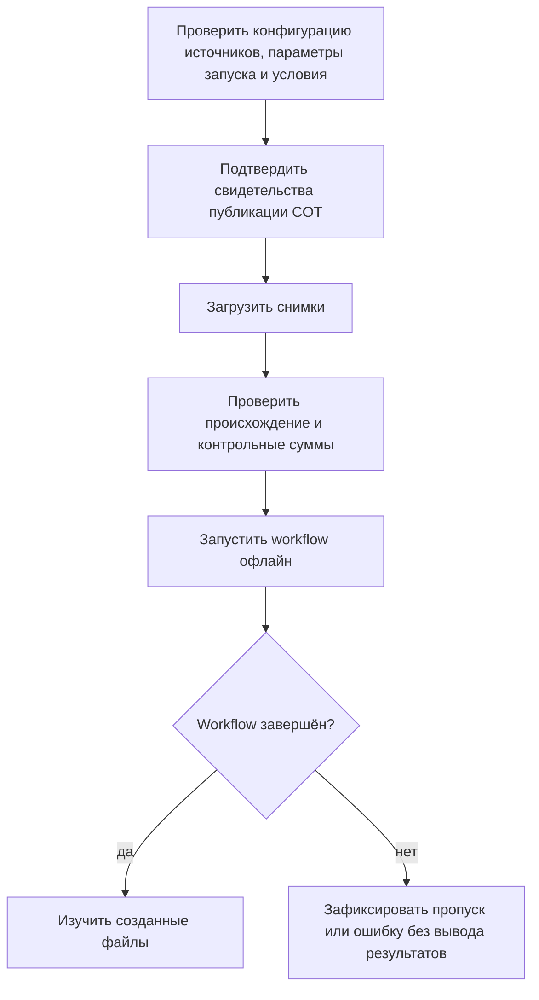
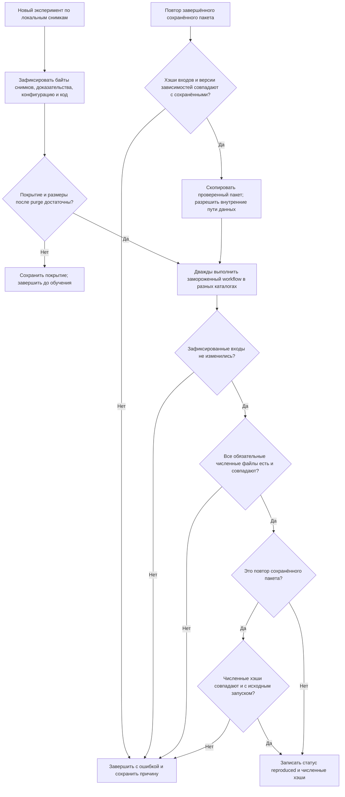
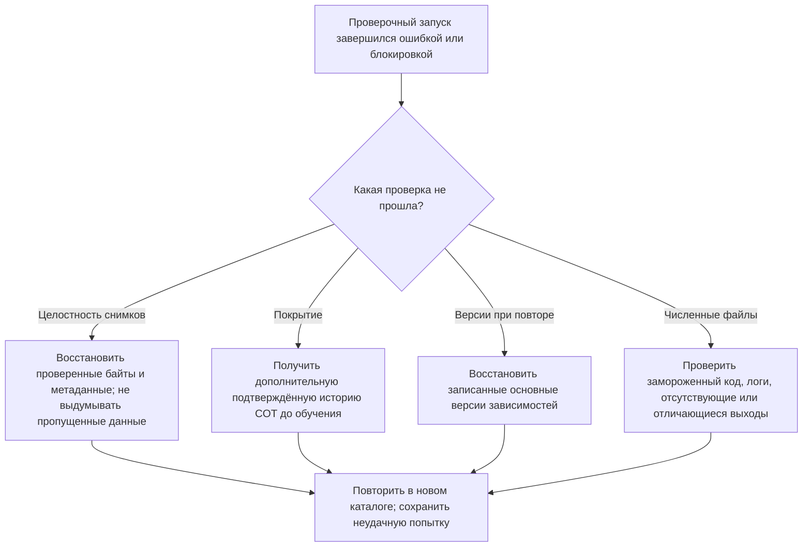

[EN](RUNBOOK.md) | [RU](RUNBOOK.ru.md)

# Локальный запуск исследования

Замороженный полный запуск с COT и офлайн-повтор выполнены; точные входы, команды, хэши и ограничения приведены в [отчёте эксперимента](FULL_RUN.ru.md). Новый набор данных всё равно должен пройти проверки доступности и покрытия. Частичные файлы сами по себе не доказывают успешное воспроизведение или прибыльность.

## Требования

Нужны Python 3.11+, `uv`, доступ к пакетным и финансовым источникам и достаточно места на диске. Выполняйте команды из корня проекта. Загруженные данные и результаты хранятся локально и исключены из Git; не записывайте учётные данные в файлы и историю. Lockfile создан, но чистая установка всех зависимостей разработки пока не подтверждена.

```bash
export UV_PROJECT_ENVIRONMENT=.run/venv UV_CACHE_DIR=.run/uv-cache
uv sync --locked --extra dev
```

## Загрузка и воспроизведение



Решение об изучении результатов принимается по фактическим свидетельствам: исследовательские выходы рассматриваются как результаты только после успешного полного запуска. Тесты на фикстурах и частичные загрузки не подтверждают завершённый эксперимент.

1. Проверьте [`config/config.yml`](../config/config.yml), [`config/settings.yml`](../config/settings.yml), условия использования и ограничения источников в [корневом README](../README.md).
2. Добавьте в `config/release_dates.csv` достаточно независимо подтверждённых пар дат отчёта и публикации. Столбцы: `report_date,available_at,source_url`; укажите время в UTC и HTTPS-ссылку на подтверждение. Учитывайте праздники и внештатные задержки. Дата наблюдения и плановый график не подтверждают публикацию. Сохраните источники доказательств и учитывайте возможные пересмотры истории.
3. Загрузите локальные снимки:

   ```bash
   uv run capstone download --config config/config.yml --settings config/settings.yml
   ```

   По умолчанию загрузчик учитывает кэш и допускает безопасный повторный запуск: корректные по SHA-256, источнику и полноте снимки пропускаются. Свежесть архива CFTC текущего года задаётся `download_cache_ttl_hours` в `config/settings.yml` (по умолчанию 24 часа); проверенные исторические архивы используются повторно. Для обновления всех источников используйте `make download-refresh` или добавьте `--force` к команде CLI. Лог показывает решения по каждому источнику, ошибки проверок, покрытие загруженных строк/дат, SHA-256 и итоговую сводку. Ответ проверяется до записи и не заменит пригодный старый снимок при ошибке.

4. Выполните workflow из локальных снимков:

   ```bash
   uv run capstone run --config config/config.yml --settings config/settings.yml --offline
   ```

   Команда `uv run capstone features --config config/config.yml --settings config/settings.yml --offline` выполняет только этап признаков. `--config` задаёт период, источники и набор активов, а `--settings` — параметры исследования и запуска. Сокращения `make data`, `make run`, `make run-notebook` и `make test` используют значения по умолчанию. `make run-notebook` открывает `notebooks/workflow.ipynb` в Jupyter из корня проекта.

5. После успешного запуска изучите `artifacts/summary.json`, метрики модели, EDA, графики капитала и `latest_signals.csv`. Поле `model_training_last_exit` показывает границу обучающих меток: свежая дата сигнала не означает недавнего обучения зафиксированной модели. Для повтора сохраните снимки и конфигурацию: обновление может заменить снимок. Офлайн-режим проверяет контрольные суммы и не подменяет отсутствующие входы сетевой загрузкой.

## Замороженный эксперимент и независимый повтор

Проверочный запуск выполняет `python -m capstone.research`; режим `--replay` использует завершённый сохранённый пакет. [Записанные команды](FULL_RUN.ru.md#команды-хэши-и-повтор) различают новое получение данных и повтор существующего эксперимента. Оба пути ниже читают локальные снимки без обновления у провайдеров.



### Восстановление после отказа проверочного запуска

Сохраните каталог неудачной попытки как доказательство и выберите новый для следующей. Разберите отказавшую проверку до изменения входов или настроек; результат holdout не должен становиться целью настройки.



## Проверка и устранение проблем

```bash
uv run --locked --extra test python -m pytest -q
```

Проверьте пропуски и отсутствующие зависимости в выводе. При ошибке DNS или поставщика восстановите доступ либо используйте ранее полученные проверенные снимки; workflow не должен выдумывать данные. При недостаточном реестре публикаций до оценки нужны дополнительные документированные подтверждения. Старые рыночные снимки без метаданных времени начала запроса необходимо обновить, чтобы незавершённые свечи не стали доступными задним числом. Фиксируйте реальные ошибки и результаты тестов; тесты на фикстурах не подтверждают полный запуск.

Чтобы проверить чистое клонирование из настроенного Git-источника, задайте `CAPSTONE_E2E_ORIGIN` как URL репозитория проекта или локальный Git-репозиторий и при необходимости `CAPSTONE_E2E_GIT_REF` как ветку или тег:

```bash
CAPSTONE_E2E_ORIGIN=https://github.com/OWNER/REPOSITORY.git CAPSTONE_E2E_GIT_REF=main make e2e-origin
```

Опциональный тест клонирует репозиторий во временный каталог `.run/e2e/`, который затем удаляется, устанавливает тестовые зависимости из lockfile и запускает smoke-, unit- и integration-тесты из клона. Финансовые данные он не загружает и E2E на реальных данных не запускает. В выбранной ветке/теге тест уже должен присутствовать. В текущем checkout Git remote не настроен, поэтому проверить клонирование отсюда пока нельзя.
